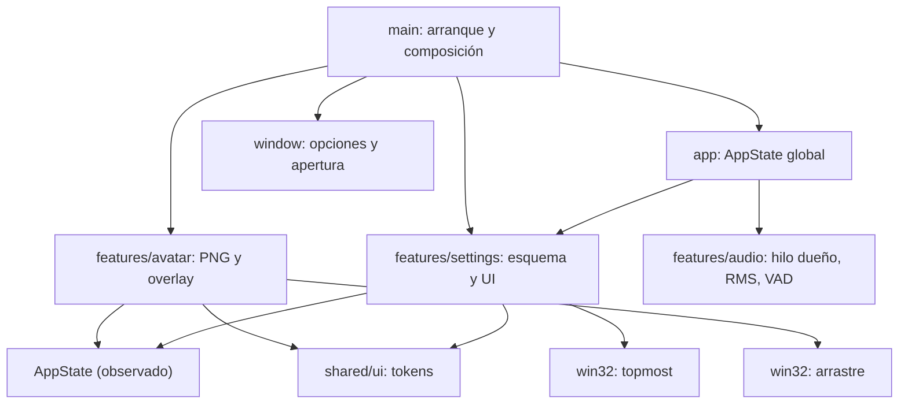
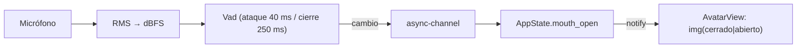

# Arquitectura

Monolito modular por features, con fronteras explícitas entre estado, sistema
operativo y vista. Es la misma forma de `gentle-shell-gpui`, reducida a lo que
este producto necesita.

## Componentes



| Pieza | Responsabilidad | No hace |
| --- | --- | --- |
| `src/main.rs` | `application().run`, rutas, ajustes, ventana del avatar, primer arranque | lógica de producto |
| `src/app.rs` | `AppState`: ajustes, boca, estado de audio, handles; bomba canal → `notify` | dibujar ni decidir VAD |
| `src/window.rs` | `WindowOptions` de overlay/ajustes, abrir ajustes, redimensionar, aparcar/mostrar | controles |
| `src/win32.rs` | arrastre manual con `SetWindowPos`, topmost, aparcado fuera de pantalla y atajo `Ctrl+Alt+P` | reglas de negocio |
| `features/avatar` | validar/copiar PNG, decodificar una vez, render del overlay | conocer el audio |
| `features/audio` | enumerar dispositivos, hilo dueño, stream cpal, VAD, eventos | tocar GPUI |
| `features/settings` | esquema v1, rutas de datos, escritura atómica, UI | dibujar el avatar |
| `shared/ui` | tokens y piezas visuales | conocer features |

## Hilos

```text
Hilo principal (GPUI)
  overlay + ajustes
        ▲
        │ async-channel (solo cambios de boca / estado)
        │
Tarea GPUI ── recv().await ── AppState::on_audio_event → notify
        ▲
        │ async-channel acotado (8)
        │
Hilo dueño de audio ── dormido en recv_blocking
        │  Apply(config)
        ▼
Stream WASAPI (cpal) ── callback: RMS → VAD → try_send solo al cambiar
        │
        └─ AtomicU32 con el último dBFS (solo lo lee la vista de ajustes)
```

- El callback de captura no asigna, no bloquea y no consulta el reloj.
- El hilo dueño reconcilia la configuración: apaga, enciende, cambia de
  dispositivo o solo actualiza la sensibilidad (atómica, sin reconstruir).
- En silencio no se notifica a la UI. Hablando hay una notificación por
  transición, no un frame por buffer.
- Un cambio de boca produce **una** notificación; la vista observa `AppState`.
- El medidor de nivel no usa el canal: lee un `AtomicU32` cada 45 ms mientras
  la ventana de ajustes está abierta. El overlay no se redibuja por el nivel.
- El arrastre no usa el bucle modal de Windows: una tarea de GPUI lee el
  cursor cada 16 ms y mueve el `HWND` con `SetWindowPos`. El hilo del atajo
  global solo atiende `WM_HOTKEY` y mueve el mismo `HWND` fuera/dentro del
  escritorio virtual.

## Flujo de datos



La posición y el tamaño se leen de `Window::bounds()` después del arrastre
nativo y se persisten en `settings.json`. Al arrancar, `window::avatar_bounds`
restaura esos valores.

## Persistencia

```text
%APPDATA%\pngtuber-lite\
├── settings.json      esquema v1
└── avatars\
    ├── closed.png
    └── open.png
```

- JSON corrupto o `schema_version != 1` → valores por defecto.
- Escritura en `settings.json.tmp` + `fs::rename` (en Windows reemplaza).
- Los PNG se copian al directorio de datos para no depender del original.

## Reglas de dependencia

1. `vad.rs` y `settings/mod.rs` no dependen de GPUI ni de cpal.
2. `stream.rs` depende de cpal, nunca de GPUI.
3. Las vistas dependen de `AppState` y `shared`; nunca al revés.
4. `shared` no conoce ningún feature.
5. `unsafe` solo en `win32.rs` (plataforma) y aislado por función.
6. Los tipos se quedan privados salvo que crucen una frontera real.

## Decisión sobre GPUI

GPUI en Windows mantiene un hilo de VSync que invalida las ventanas visibles en
cada refresco. Eso fija un piso de CPU (~1,2 % de un núcleo medido en el
proyecto base de 1000×700). Se acepta en el MVP. Si en el futuro se exigiera
0 %, el overlay migraría a `WS_EX_LAYERED` + `UpdateLayeredWindow` sin tocar
`vad.rs`, `settings` ni `app.rs`; el resto de la arquitectura ya está separado.
