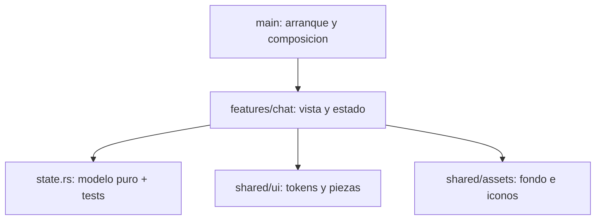
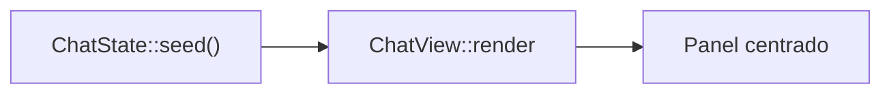

# Arquitectura

Maqueta de chat de un solo binario, organizada como `gentle-shell-gpui`:
**monolito modular por features** con fronteras explicitas entre vista,
logica pura y recursos.

## Componentes

| Pieza | Responsabilidad |
| --- | --- |
| `src/main.rs` | Arranque: assets, fuentes, ventana. Sin logica ni vistas. |
| `src/lib.rs` | Biblioteca: expone `features` y `shared`; el binario queda fino y lo `pub` no es codigo muerto. |
| `src/features/chat` | El chat: `mod.rs` (API publica), `state.rs` (modelo puro), `view.rs` (Render). |
| `src/shared/ui.rs` | Tokens (`panel, surface, raised, fg, accent…`) y piezas (`card, chip, kbd, screen_header, field`). Sin logica de producto. |
| `src/shared/assets.rs` | `AssetSource`: sirve fondo e iconos empaquetados, delega el resto al Kit. |

## Reglas de dependencia

1. `state.rs` no depende de GPUI ni de IO: solo `String` y enums. Es lo testeable.
2. `view.rs` consume `state` y `shared`; nunca al reves.
3. `shared` no conoce ningun feature ni tiene reglas de negocio.
4. Un modulo sube a `shared/` solo cuando lo usan dos o mas features.
5. Los tipos se quedan privados salvo que sean contrato real entre modulos
   (`ChatView`, `ChatState`, `Message`, `Role` son la API de `features/chat`).
6. Nada de traits ni crates de un solo uso.
7. Cada refactor preserva comportamiento; el CI lo verifica.

## Flujo de datos

Hoy el estado es fijo (maqueta visual): el seed alimenta el render y no hay
eventos de vuelta. Cuando haya backend, los efectos iran en metodos de
`ChatView` y el estado puro seguira en `state.rs`.
